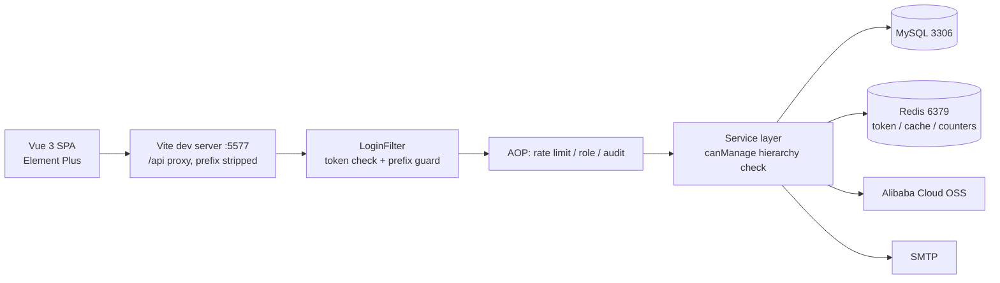

<div align="center">

# Hundun-Bone

**Account, permission and feedback management — Spring Boot 3 + Vue 3**

Authentication, rate limiting and audit trails are all hand-written. No Spring Security.


</div>

> 中文文档是主文档，内容更完整：[README.md](README.md)。本文件是精简英文版，只覆盖定位、架构、启动与文档索引，不做逐句对译。

## What it is

A three-tier management system — **administrator / mailbox / user** — built around a deliberately uncomfortable trade-off: give users as much freedom as possible (five ways to sign in, edit their own profile, delete their own account) *without* letting that freedom make the system brittle (privilege escalation, credential stuffing, header spoofing, malicious uploads).

- **One account table, five login methods.** Username / email / phone with password, plus passwordless email-code login. Avatars and attachments live in Alibaba Cloud OSS.
- **Role layering on a single column.** No role table, no permission table. `users.status` encodes both *identity* and *availability* (positive = active, negative = banned, absolute value = tier), guarded by three independent layers: filter → AOP aspect → service-level hierarchy check.
- **Feedback loop plus full audit trail.** Submit → async mail to every admin → handle in the console → receipt mail back to the author. Every write operation lands in `operation_log` with duration and the parameterised SQL skeleton.

The part that distinguishes this from a course CRUD project is a **security audit pass** in October 2026: eight consecutive commits closing P0/P1/P2 findings, each leaving a verifiable defence in the code. See the [中文 README](README.md#安全设计) for the threat → mitigation → file breakdown.

## Stack

| Layer | Choice |
| --- | --- |
| Runtime | Java 17 |
| Framework | Spring Boot 3.5.8 |
| Persistence | MyBatis 3.0.5 + PageHelper 1.4.7 (SQL lives in XML) |
| Storage | MySQL 8.0 |
| Cache / session | Redis (Lettuce) |
| Auth | jjwt 0.11.5, HS256 — hand-rolled `LoginFilter` + AOP, **not** Spring Security |
| Password | jBCrypt, 12 rounds |
| Files | Alibaba Cloud OSS SDK 3.17.1 |
| Mail | JavaMail, SMTP 587 + STARTTLS |
| Frontend | Vue 3.5 + Vue Router 5 + Pinia 3 + Element Plus 2.13 |
| Build | Vite 7.3, pnpm (only `pnpm-lock.yaml` is tracked) |

## Architecture



Two things worth knowing up front:

1. In development the frontend only calls `/api/xxx`; Vite proxies to `5757` and **strips the `/api` prefix**, so the backend sees `/xxx`. In production that proxy is gone — you must add an equivalent reverse-proxy rule.
2. The JWT is only a carrier. The real session lives in Redis under `token:{id}` with a 30-minute sliding TTL, so banning, deleting or logging out a user revokes access immediately instead of waiting for token expiry.

## Permission model

| `status` | Meaning |
| --- | --- |
| `1` | Regular user |
| `-1` | Regular user, banned |
| `2` | Administrator |
| `-2` | Administrator, banned (also used for pending invite placeholders) |
| `3` | Super administrator |

Defence in depth: the filter rejects banned accounts and any `/admin` prefix for non-admins; the aspect re-reads the role **from the database** for each `@RequireRole` method (never from cache); the service layer enforces "you cannot manage a peer or a superior".

Admins are invited, not created by hand: a super admin generates a 10-character code which inserts a placeholder row with `status = -2`; the invitee registers against it and the placeholder is deleted. The `username` unique index guarantees single use.

## Quick start

Requirements: **JDK 17**, Maven 3.8+, MySQL 8.0+, Redis 6.0+, **Node `^20.19.0` or `>=22.12.0`**, pnpm 9+.

```bash
# 1. database
mysql -uroot -p -e "CREATE DATABASE fifteen_hundun DEFAULT CHARACTER SET utf8mb4;"
mysql -uroot -p fifteen_hundun < file/hundun.sql

# 2. required environment variables (startup fails without them)
export JWT_SECRET="at-least-32-bytes-long-secret-key"
export MAIL_AUTH_CODE="smtp-auth-code"
export ALIYUN_ACCESS_KEY_ID="..."
export ALIYUN_ACCESS_KEY_SECRET="..."

# 3. backend on :5757
cd back-end/fifteen-hundun && mvn spring-boot:run

# 4. frontend on :5577
cd front-end/hundun-front && pnpm install && pnpm dev
```

> [!IMPORTANT]
> `JWT_SECRET` (≥ 32 bytes), `MAIL_AUTH_CODE` and both OSS keys are validated in constructors — a missing value aborts startup rather than failing at runtime. All other settings have defaults; see the [中文 README](README.md#快速开始) for the full table.

> [!WARNING]
> If you see `Unable to connect to Redis`, check `fifteen-hundun.redis.timeout: 10` in `application-dev.yml` — Spring Boot 3 reads a unit-less number as **10 milliseconds**, which is shorter than a Lettuce handshake. Start with `--spring.data.redis.timeout=5s` or change it to `10s`.

To promote an account after registering:

```sql
UPDATE users SET status = 2 WHERE username = 'your-name';  -- 3 for super admin
```

## Project layout

```text
back-end/fifteen-hundun/src/main/java/com/createpen/fifteenhundun/
├── common/      annotations, config, constants, ThreadLocal context, exceptions, utils
├── framework/   aspects (rate limit / role / audit / time-fill) and interceptors (LoginFilter, SQL capture)
└── module/
    ├── admin/   user management, invite codes, log queries
    ├── auth/    five login flows, registration, logout
    └── user/    profile, avatar, feedback, generic upload

front-end/hundun-front/src/
├── api/       per-module request wrappers
├── router/    route table + global guard (permission check lives here)
├── stores/    Pinia: user (manual localStorage persistence), feedback
├── utils/     axios instance, login redirect, logout, global error notification
└── views/     login / user / admin / help
```

## API

29 endpoints across five groups — full request/response reference in **[docs/API.md](docs/API.md)** (Chinese).

| Group | Count | Prefix |
| --- | --- | --- |
| Auth | 6 | `/user/login/**` |
| User | 8 | `/user/**` |
| Admin | 9 | `/admin/**` |
| Feedback | 4 | `/feedback/**` |
| Common | 1 | `/files` |

## Status

| State | Contents |
| --- | --- |
| **Done** | Five login methods, registration and profile editing, avatar/file upload, paginated user search and field-level editing, invite-based admin onboarding, feedback submit/handle/mail receipt, audit logging, dual-dimension rate limiting, immediate token revocation |
| **In progress** | Frontend lint chain (`eslint` / `oxlint` binaries and `eslint.config.js` are missing, so `pnpm lint` fails), `GET /admin/logs` should take query parameters instead of a request body |
| **Not started** | `memo` module (table and constant only), WebSocket (exporter registered, no `@ServerEndpoint`), scheduled tasks (`@EnableScheduling` on, no `@Scheduled`) |

Known issues are documented in the [中文 README](README.md#已知问题) — including the 10 ms Redis timeout, two coexisting error semantics, and a dropped verification code when changing phone numbers.

## Screenshots

| | |
| --- | --- |
|  |  |
|  |  |
|  |  |

---

Licensed under the [Mulan Permissive Software License, Version 2 (Mulan PSL v2)](LICENSE).
