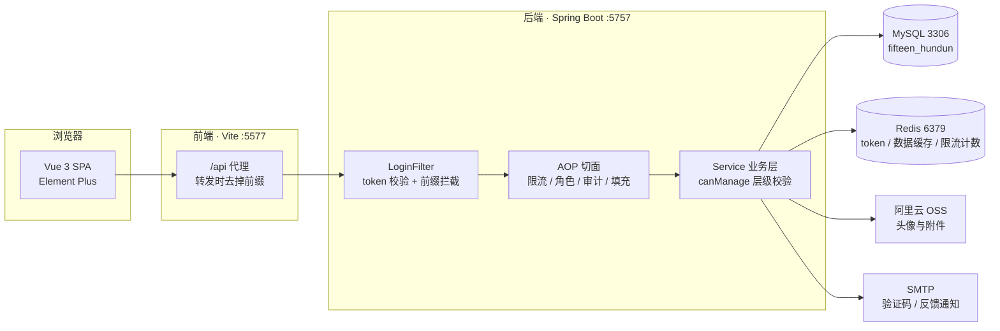
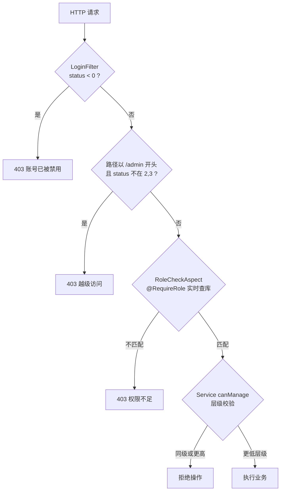
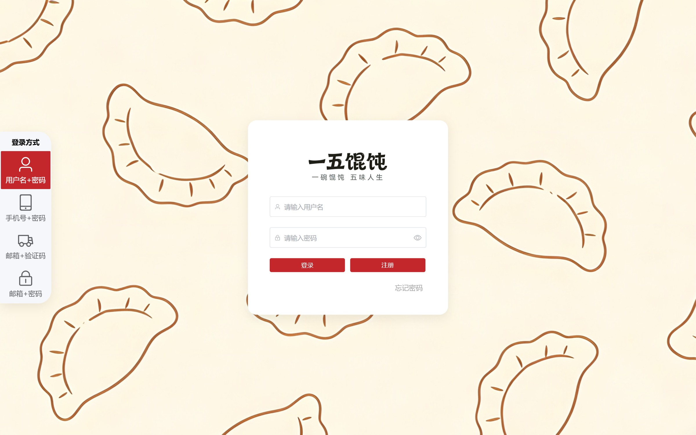
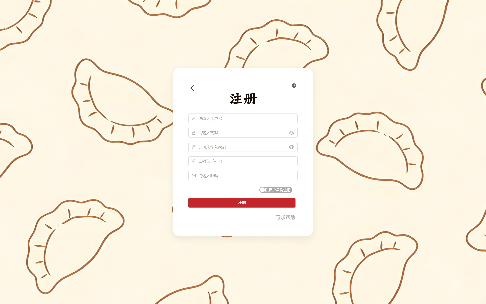
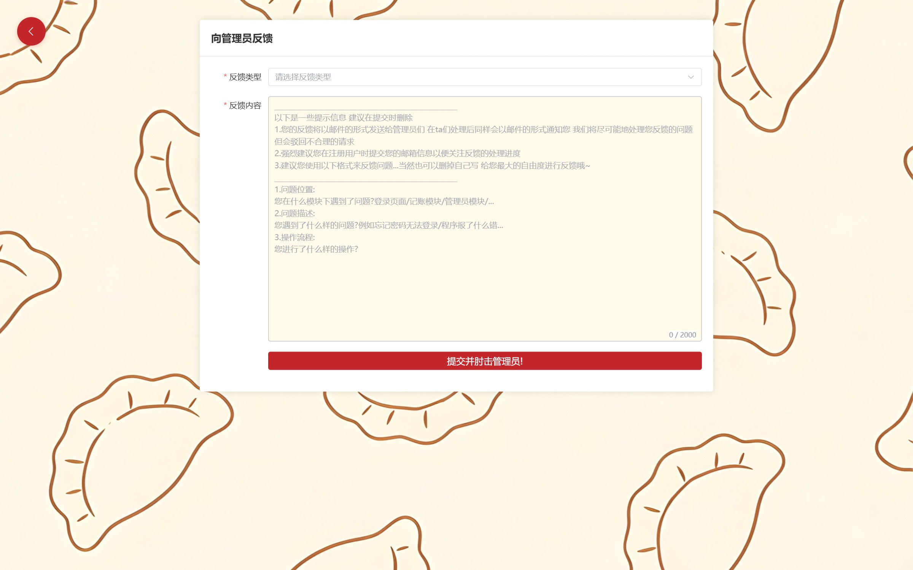
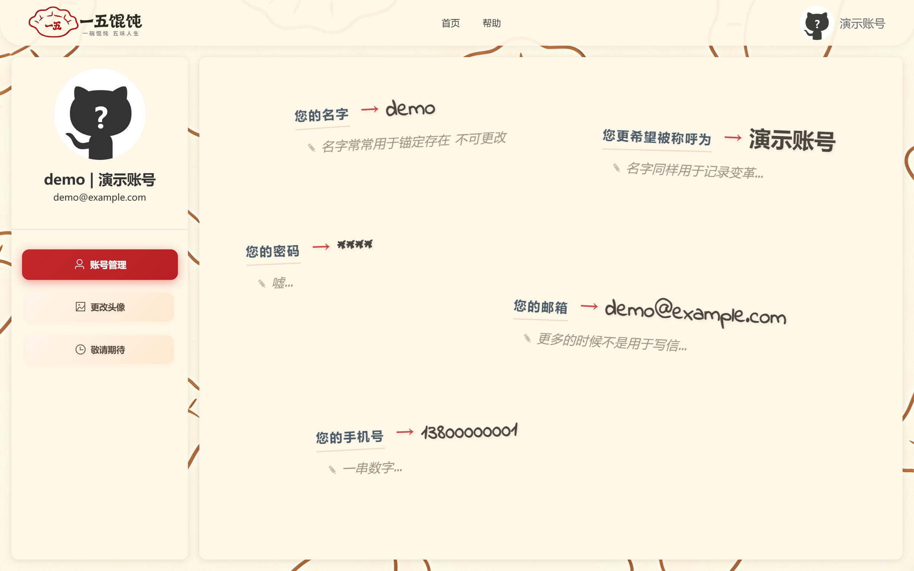
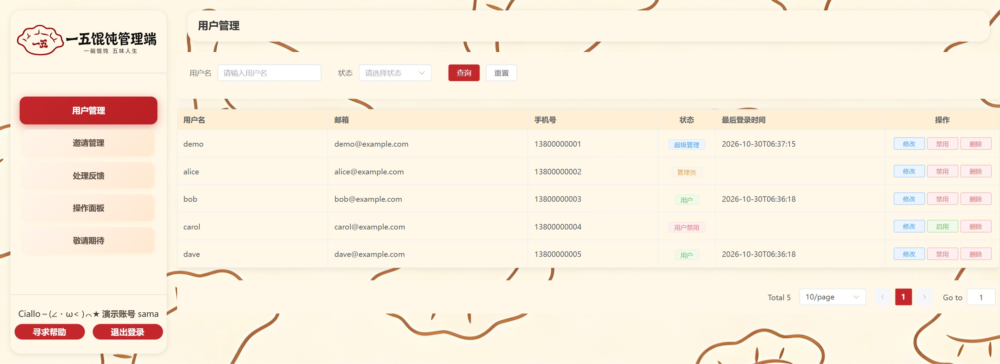
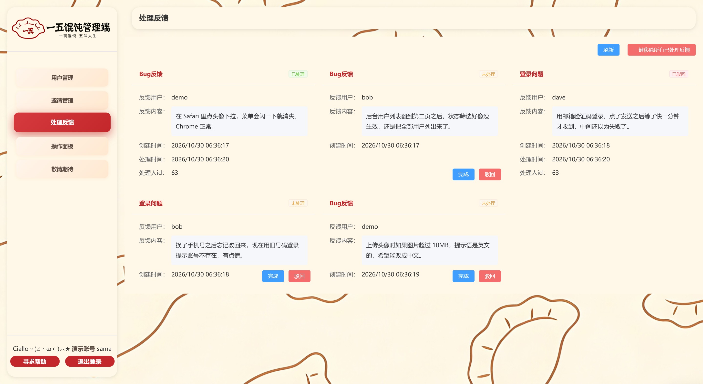

<div align="center">

# Hundun-Bone · 馄饨骨架

**Spring Boot 3 + Vue 3 的账号 · 权限 · 反馈管理系统**

鉴权、限流、审计三条链路全部手写，不依赖 Spring Security。


</div>

---

## 这是什么

一个「管理员 — 邮箱 — 用户」三段式的管理系统。设计上想在两件通常互斥的事之间找平衡：**给用户尽量大的自由**（多种登录方式、自己改资料、自己注销账号），**同时不让程序因为这份自由变脆**（越权、撞库、伪造 IP、上传木马）。

三个核心能力：

- **一套账号体系，五种登录方式**。用户名 / 邮箱 / 手机号配密码，外加邮箱验证码免密登录。注册即用，头像与文件走阿里云 OSS。
- **单字段角色分层**。不建角色表、不建权限表，`users.status` 一个字段同时表达「身份」和「可用状态」，再由过滤器 + 切面 + 业务层三层拦截，实现普通用户 / 管理员 / 超管的分级管理。
- **反馈闭环 + 全链路审计**。用户提交反馈 → 异步邮件通知全体管理员 → 后台处理 → 回执邮件发给提交人；每一次写操作自动落 `operation_log`，含耗时与执行的 SQL 骨架。

这套代码里还有一件刻意做的事：2026 年 10 月做过一轮**完整的安全审计**，连续 8 个 commit 依次修掉 P0 / P1 / P2 问题，并在代码里留下对应防线。这是本项目区别于一份普通 CRUD 作业的地方，详见 [安全设计](#安全设计)。

## 技术栈

### 后端

| 类别 | 选型 | 版本 |
| --- | --- | --- |
| 运行时 | Java | 17 |
| 框架 | Spring Boot | 3.5.8 |
| 持久层 | MyBatis + PageHelper | 3.0.5 / 1.4.7 |
| 数据库 | MySQL | 8.0 |
| 缓存 | Redis（Lettuce） | 6.0+ |
| 认证 | jjwt（HS256） | 0.11.5 |
| 密码 | jBCrypt（rounds = 12） | 0.4 |
| 文件存储 | 阿里云 OSS SDK | 3.17.1 |
| 邮件 | JavaMail（SMTP + STARTTLS） | 1.6.2 |
| 切面 | Spring AOP：限流 / 角色 / 审计 / 时间填充 | — |

### 前端

| 类别 | 选型 | 版本 |
| --- | --- | --- |
| 框架 | Vue 3（Composition API + `<script setup>`） | 3.5.30 |
| 路由 | Vue Router | 5.0.4 |
| 状态 | Pinia（setup store） | 3.0.4 |
| UI | Element Plus + Icons | 2.13.6 |
| 请求 | axios | 1.13.6 |
| 构建 | Vite | 7.3.1 |
| 样式 | Less | 4.6.4 |
| 包管理 | pnpm（仓库只跟踪 `pnpm-lock.yaml`） | 9+ |

### 几个刻意的取舍

- **不用 Spring Security**。整条鉴权链只有一个两百行左右的 `LoginFilter` 加一个 `RoleCheckAspect`，每一步都能读懂；代价是没有框架兜底，必须自己保证不漏——这正是 [安全设计](#安全设计) 那一节存在的原因。
- **不用 MyBatis-Plus**。SQL 全部手写在 `mapper/*.xml` 里，分页交给 PageHelper。换取的是对「这条 SQL 到底长什么样」的完全掌控，这也是审计日志能记录 SQL 骨架的前提。
- **不用 TypeScript**。项目起步于课程作业，全程 JavaScript，`jsconfig.json` 只做 `@/` 路径别名。
- **不用 pinia 持久化插件**。token 与 userInfo 的 localStorage 读写手写在 `stores/user.js` 里，共二十来行，行为完全可见。

## 系统架构



两条链路值得留意：

1. **开发态**：前端只写 `/api/xxx`，由 Vite 开发服务器代理到 `5757` 并把 `/api` 前缀**去掉**，所以后端收到的真实路径是 `/xxx`。生产打包后这层代理不存在，需要在网关或 nginx 上补等价配置，否则静态页面里的 `/api/*` 会 404。
2. **运行时**：`LoginFilter` 是唯一入口守卫，它同时负责三件事——解析并比对 token、拒绝被封禁账号、把 `id` / `username` 写进 `ThreadLocal` 供后续切面取用，请求结束在 `finally` 里清理。

## 权限模型

角色不单独建表，全部压在 `users.status` 一个字段上：

| status | 含义 | 说明 |
| --- | --- | --- |
| `1` | 普通用户 | 注册后的默认值 |
| `-1` | 普通用户（封禁） | 无法登录，token 已被吊销 |
| `2` | 管理员 | 可管理普通用户、处理反馈 |
| `-2` | 管理员（封禁） | 同时被用作「邀请码占位账号」的状态 |
| `3` | 超级管理员 | 可管理除超管外的所有人、可签发邀请码 |

「身份」和「状态」共用正负号：**正值可用、负值封禁**，绝对值表示层级。这样一次登录前置校验就能同时判断「是不是被封了」和「该给多大权限」，代价是任何改动这个字段的地方都要想清楚正负号。

### 三道防线



为什么要三层，而不是一层做完：

- **过滤器看路径前缀**，零成本，挡住绝大多数「普通用户手输 `/admin` 地址」的尝试；
- **切面看注解**，精确到方法，且**每次实时查库**而不是读缓存——管理员刚被降级时，缓存里的旧权限不能继续生效；
- **业务层看层级关系**，处理「管理员不能删另一个管理员」「谁都不能动超管」这类规则，这类判断依赖具体目标对象，注解表达不了。

三层各拦一类错误，任何一层单独失效，另外两层仍在。

### 邀请码机制

新增管理员不需要超管手动建号：

1. 超管调用 `GET /admin/invite-code`，系统生成 10 位随机码，并插入一条**占位账号**（用户名固定为 `管理员待注册{code}`，状态 `-2`，密码为随机 UUID 的哈希）；
2. 把码交给对方，对方调 `POST /user/register/admin` 凭码注册（此接口免登录，但有限流）；
3. 注册成功后删除占位账号，新账号状态为 `2`。

占位账号占用 `username` 唯一索引，等于借数据库的唯一约束保证「一个邀请码只能用一次」，不需要额外的核销表。

## 安全设计

以下是那轮审计留下的七道防线。每一条都按「威胁 → 对策 → 位置」组织，可以直接对照代码验证。

### 1. 登录限流：IP 与账号双维度

**威胁**：撞库、密码爆破、验证码接口被当作邮件轰炸机。

**对策**：自定义 `@RateLimit(count, time, key, resetOnSuccess)`，用 Redis 固定窗口计数（`INCR` + `EXPIRE`），**同时对 IP 和账号标识两个维度计数**。只按 IP 记，换代理就能绕过；只按账号记，攻击者可以拿一个 IP 横扫所有账号。两个维度同时生效，任一超限即拒绝。

`resetOnSuccess = true` 用在登录接口上：登录成功后**只重置账号维度**的计数，IP 维度保留。否则攻击者可以先用正确密码登录一次清零，再继续爆破同 IP 上的其他账号。

**位置**：`framework/aspect/RateLimitAspect.java`、`common/anno/RateLimit.java`

**验证**：`RateLimitAspectTest` 覆盖了 6 个场景，包括「换 IP 打同一邮箱仍被拒」「同 IP 换邮箱可以过」「窗口过期后恢复」「Redis key 里绝不出现密码」。

### 2. 邮箱验证码：恒定时间比较 + 一次性

**威胁**：验证码被暴力枚举，或通过响应耗时差反推。

**对策**：6 位纯数字用 `SecureRandom` 生成，Redis TTL 5 分钟，发送接口限流 3 次 / 分钟（IP 与邮箱双维度）。校验用 `MessageDigest.isEqual` 做**恒定时间比较**，避免 `equals` 在首个不同字符处提前返回造成时间侧信道。

登录成功或改密成功后**立即删除**验证码，杜绝重放。同一套逻辑同时服务于「邮箱验证码登录」和「用邮箱验证码改密码」两条路径。

**位置**：`common/util/email/EmailCodeUtil.java`、`module/auth/service/impl/LoginServiceImpl.java`

### 3. JWT 只是载体，会话真身在 Redis

**威胁**：JWT 天然无法撤销——用户被拉黑、被删除、主动登出之后，手里的 token 在过期前依然有效。

**对策**：JWT 载荷只放 `id` 和 `username`（不放角色，避免权限固化在令牌里），HS256 签名，密钥长度不足 32 字节直接拒绝启动。

真正的会话状态在 Redis：`token:{id}` 存一份完整 token，TTL 30 分钟且**每次请求续期**。也就是说 JWT 自身有效期虽是 24 小时，但**实际会话超时是 30 分钟滑动窗口**。封禁、删除用户、管理员调整用户状态、用户主动登出，都会立即删除这个 key，token 当场失效。

Redis 不可用时，`LoginFilter` 退化为「只验 JWT 签名」并放行——宁可短暂放宽，也不让缓存故障演变成全站不可登录；代价是那段时间内吊销失效，属于有意识的权衡。

**位置**：`common/util/JwtUtil.java`、`framework/interception/LoginFilter.java`、`module/user/cache/UserRedisService.java`

### 4. 越权：三层拦截

**威胁**：普通用户直接请求管理端接口（水平越权）；管理员操作同级或超管账号（垂直越权）。

**对策**：即上文 [权限模型](#权限模型) 的三道防线。补充两个细节：

- `RoleCheckAspect` 取角色时**绕开缓存直接查库**。缓存里存的是展示用数据，权限判断不能信任可能过期的副本。
- `canManage` 在 `AdminServiceImpl` 和 `UserServiceImpl` 里各有一份实现，规则一致：超管可管除超管外所有人，普通管理员只能管 `1` / `-1`，谁都不能动超管。

**位置**：`framework/aspect/RoleCheckAspect.java`、`module/admin/service/impl/AdminServiceImpl.java`、`module/user/service/serviceimpl/UserServiceImpl.java`

### 5. Redis 反序列化白名单

**威胁**：`GenericJackson2JsonRedisSerializer` 会把 `@class` 类型信息一起写进缓存值，反序列化时按类名实例化——只要有人能往 Redis 里写一个构造好的字符串，就是一个现成的 gadget 链入口。

**对策**：`BasicPolymorphicTypeValidator` 只放行四个包前缀：`com.createpen.fifteenhundun.`、`com.github.pagehelper.`、`java.util.`、`java.time.`，其余一律拒绝。同时把 `LocalDateTime` 固定为 `yyyy-MM-dd HH:mm:ss` 格式并忽略未知字段，避免类字段增删导致老缓存整批读取失败。

**位置**：`common/config/RedisConfiguration.java`

### 6. 上传：扩展名白名单 + 文件魔数

**威胁**：把 `.jsp` / `.html` 改名成 `.png` 上传；或上传超大文件打满磁盘。

**对策**：单文件上限 10 MB（`UPLOAD_MAX_SIZE_BYTES` 可调）；扩展名白名单分两组——图片 `jpg/jpeg/png/gif/webp/bmp`，文档 `pdf/txt/md/doc/docx/xls/xlsx/ppt/pptx`，头像额外限制只收图片。**图片还要读文件头验证魔数**：JPEG `FF D8 FF`、PNG `89 50 4E 47`、GIF `GIF8`、BMP `BM`、WebP `RIFF....WEBP`，改后缀绕不过去。

对象名统一为 `{username}/avatars/{uuid}.{ext}` 与 `{username}/files/{uuid}.{ext}`，原始的 `../` 之类路径字符完全不参与拼接。换头像时先删旧图，上传失败则回滚删除新文件。

**位置**：`common/util/FileUploadValidator.java`、`common/util/AliOSSUtil.java`

### 7. 审计日志不含敏感值

**威胁**：操作日志表里躺着明文密码、邮箱、手机号，一旦日志被导出就是一次数据泄露。

**对策**：`CurrentSqlInterceptor` 拦截 MyBatis 的 `StatementHandler`，从 `BoundSql` 取出的是**带 `?` 占位符的 SQL 骨架，参数值不参与**，所以日志里永远不会出现密码或邮箱。`User` 的 `passwordHash` 与 `inviteCode` 都加了 `@JsonIgnore`，既不进 JSON 响应也不进缓存。

IP 取值的默认策略是「只信 `remoteAddr`」，只有显式设置 `TRUST_PROXY_HEADERS=true`（即确认部署在可信反向代理之后）才会读取 `X-Forwarded-For`，并对取到的值做 IPv4 / IPv6 字面量校验——否则任何人都能伪造 `XFF` 绕过限流。

**位置**：`framework/interception/CurrentSqlInterceptor.java`、`framework/aspect/AutoLogAspect.java`、`common/util/IpUtil.java`

> 审计过程本身留在 git 历史里：`142200c` → `dc2e06e` → `a182c8c` → `99dd9ff` → `65e15f4`，依次对应 P0 凭据外置与 RBAC、P1 上传与 CORS、P2 IP 伪造与分页、删除越权、token 吊销与日志脱敏。

## 快速开始

### 环境要求

| 依赖 | 版本 | 备注 |
| --- | --- | --- |
| JDK | 17 | `pom.xml` 的 `java.version` 为 17 |
| Maven | 3.8+ | 仓库无 wrapper，需本机安装 |
| MySQL | 8.0+ | 库名 `fifteen_hundun` |
| Redis | 6.0+ | 默认 `localhost:6379`，库 0 |
| Node.js | `^20.19.0` 或 `>=22.12.0` | Vite 7 的硬性要求，Node 16 / 18 会直接报错 |
| pnpm | 9+ | 仓库只跟踪 `pnpm-lock.yaml` |

### 1. 准备数据库

```bash
mysql -uroot -p -e "CREATE DATABASE fifteen_hundun DEFAULT CHARACTER SET utf8mb4;"
mysql -uroot -p fifteen_hundun < file/hundun.sql
```

`file/hundun.sql` 是一份完整导出，包含 `users`、`feedback`、`operation_log`、`memo` 四张表，以及作者本地的一份历史操作日志数据。只想要空库的话，导入前把 `INSERT INTO` 开头的行删掉即可。

### 2. 配置环境变量

> [!IMPORTANT]
> 下面四项**没有可用默认值**，缺任意一项应用会在启动时直接抛异常退出（构造器校验，不是运行到才报错）：`JWT_SECRET` 为空或不足 32 字节、`MAIL_AUTH_CODE` 为空、OSS 的 AccessKey ID / Secret 为空。

| 变量 | 必填 | 默认值 | 说明 |
| --- | --- | --- | --- |
| `JWT_SECRET` | 是 | 无 | HS256 签名密钥，**至少 32 字节** |
| `MAIL_AUTH_CODE` | 是 | 无 | 邮箱 SMTP 授权码（不是邮箱登录密码） |
| `ALIYUN_ACCESS_KEY_ID` | 是 | 无 | 阿里云 AccessKey，上传功能需要 |
| `ALIYUN_ACCESS_KEY_SECRET` | 是 | 无 | 配合上一项使用 |
| `DB_PASSWORD` | 否 | `123456` | `application-dev.yml` 里带的弱默认值，生产务必覆盖 |
| `JWT_EXPIRATION_MILLIS` | 否 | `86400000` | JWT 自身有效期（24h），实际会话另受 Redis 30 分钟滑动窗口约束 |
| `MAIL_FROM` | 否 | 项目作者邮箱 | 发件地址 |
| `MAIL_SMTP_HOST` | 否 | `smtp.qq.com` | 端口固定 587 + STARTTLS |
| `CORS_ALLOWED_ORIGINS` | 否 | `http://localhost:5577,http://127.0.0.1:5577` | 逗号分隔白名单，不允许通配 |
| `UPLOAD_MAX_SIZE_BYTES` | 否 | `10485760` | 单文件上限 10 MB |
| `TRUST_PROXY_HEADERS` | 否 | `false` | 只有部署在可信反代之后才改 `true` |
| `REDIS_HOST` / `REDIS_PORT` / `REDIS_PASSWORD` | 否 | `localhost` / `6379` / 空 | Redis 连接 |

不想用环境变量，也可以在 `src/main/resources/` 下建 `application-secret.yml`（已在 `.gitignore` 中，不会被提交），由 `spring.config.import: optional:classpath:application-secret.yml` 自动加载。

### 3. 启动后端

```bash
cd back-end/fifteen-hundun
mvn spring-boot:run
```

或先打包再运行：

```bash
mvn clean package -DskipTests
java -jar target/fifteen-hundun-0.0.1-SNAPSHOT.jar
```

服务监听 **5757**，无 context-path。

> [!WARNING]
> 如果日志里出现 `Unable to connect to Redis`，先检查 `application-dev.yml` 的 `fifteen-hundun.redis.timeout: 10`。在 Spring Boot 3 里不带单位的数字被当作**毫秒**，也就是 10 ms —— 比一次 Lettuce 握手还短，于是连接初始化直接超时。临时绕过的办法是启动时加 `--spring.data.redis.timeout=5s`。详见 [已知问题](#已知问题)。

### 4. 启动前端

```bash
cd front-end/hundun-front
pnpm install
pnpm dev
```

开发服务器监听 **5577**，把 `/api` 代理到 `5757` 并去掉前缀。

### 5. 验证

打开 `http://localhost:5577` 应该看到登录页。注册一个账号即可走通「注册 → 登录 → 个人中心 → 提交反馈」的完整链路。

> [!NOTE]
> 端口容易记混：**前端 5577、后端 5757**，CORS 默认白名单也只放行 5577。改前端端口的话，记得同步改 `CORS_ALLOWED_ORIGINS`，否则浏览器会拦掉所有接口。

> [!TIP]
> 想让账号变成管理员，直接改库最快：`UPDATE users SET status = 2 WHERE username = '你的用户名';`（`3` 为超级管理员）。改完重新登录一次，因为前端把 `userInfo` 存在 localStorage 里，背后端每次请求都会实时查库。

## 项目结构

```text
15-hundun/
├── back-end/fifteen-hundun/                  # Spring Boot 后端
│   └── src/main/java/com/createpen/fifteenhundun/
│       ├── common/                           # 与业务无关的公共能力
│       │   ├── anno/                         # @RateLimit / @RequireRole / @AutoLog / @AutoFillTime
│       │   ├── config/                       # CORS、Redis 序列化、异步线程池、邮件、WebSocket
│       │   ├── constant/                     # 状态码、Redis key、模块名、OSS 路径
│       │   ├── context/                      # BaseContext（ThreadLocal 存当前用户）
│       │   ├── exception/                    # 全局异常处理 + 领域异常
│       │   ├── response/                     # 统一响应体 Result<T>
│       │   └── util/                         # JWT、BCrypt、OSS、邮件、IP、随机码、上传校验
│       ├── framework/                        # 与框架耦合的横切层
│       │   ├── aspect/                       # 限流 / 角色 / 审计 / 时间填充 四个切面
│       │   └── interception/                 # LoginFilter 与 SQL 采集拦截器
│       ├── module/
│       │   ├── admin/                        # 管理端：用户管理、邀请码、日志查询
│       │   ├── auth/                         # 认证：五种登录、注册、登出
│       │   └── user/                         # 用户端：资料维护、头像、反馈、通用上传
│       └── FifteenHundunApplication.java
├── front-end/hundun-front/                   # Vue 3 前端
│   └── src/
│       ├── api/                              # 按模块拆的接口封装（user / admin / feedback）
│       ├── assets/                           # 全局样式、配色备忘、图片
│       ├── router/                           # 路由表 + 全局守卫（权限判断写在这里）
│       ├── stores/                           # Pinia：user（含 localStorage 持久化）、feedback
│       ├── utils/                            # axios 封装、登录跳转、登出、全局错误通知
│       └── views/
│           ├── login/                        # 登录页、四种登录表单、注册表单
│           ├── user/                         # 用户端布局与个人中心
│           ├── admin/                        # 后台布局、侧边栏、六个功能面板
│           └── help/                         # 帮助与反馈页、提示卡片
├── file/
│   ├── hundun.sql                            # 建表语句 + 历史数据
│   └── school/                               # 项目最初的课程策划文档（历史留档）
├── docs/
│   ├── API.md                                # 全量接口文档
│   └── images/                               # 运行截图
├── README.md
├── README.en.md
└── LICENSE                                   # 木兰宽松许可证第 2 版
```

## 接口文档

共 **29 个接口**，按模块分布如下；完整的方法、路径、所需角色、限流参数、请求与响应示例见 **[docs/API.md](docs/API.md)**。

| 模块 | 接口数 | 路径前缀 | 说明 |
| --- | --- | --- | --- |
| 认证 | 6 | `/user/login/**` | 五种登录、发送验证码、登出 |
| 用户 | 8 | `/user/**` | 注册、资料维护、头像、改密、注销 |
| 管理 | 9 | `/admin/**`、`/user/register/admin` | 用户检索与维护、邀请码、操作日志、凭邀请码注册管理员 |
| 反馈 | 4 | `/feedback/**` | 提交、分页查询、处理、批量删除已处理 |
| 通用 | 1 | `/files` | 文件上传到 OSS |

> [!WARNING]
> 有两处接口签名与直觉不符，写客户端时必看：`GET /admin/logs` 用 `@RequestBody` 接收查询条件（浏览器地址栏直接访问打不通，得用 HTTP 客户端发 body）；`PUT /admin/user/status?username=xxx` 走 query 传参，没有请求体。

## 运行截图

<table>
  <tr>
    <td width="50%"><br /><sub>登录页 · 四种登录方式切换</sub></td>
    <td width="50%"><br /><sub>注册 · 可切换为管理员邀请码注册</sub></td>
  </tr>
  <tr>
    <td width="50%"><br /><sub>帮助与反馈 · 用户提交入口</sub></td>
    <td width="50%"><br /><sub>个人中心 · 账号管理与头像</sub></td>
  </tr>
  <tr>
    <td width="50%"><br /><sub>后台 · 用户检索、启禁用、逐字段编辑</sub></td>
    <td width="50%"><br /><sub>后台 · 反馈处理与批量清理</sub></td>
  </tr>
</table>

## 现状与路线图

| 状态 | 内容 |
| --- | --- |
| **已完成** | 五种登录方式 · BCrypt（rounds=12）· 注册与资料维护 · 头像与文件上传 · 用户分页检索与逐字段编辑 · 邀请码邀请管理员 · 反馈提交 / 处理 / 邮件回执 · 操作审计日志 · 双维度限流 · 封禁或删除即时吊销 token |
| **进行中** | 前端 lint 链：`pnpm lint` 依赖 `eslint` 与 `oxlint` 本体，两者当前都未安装，也没有 `eslint.config.js`，命令跑不起来 · `GET /admin/logs` 改用 query 收参 |
| **未开始** | `memo` 备忘模块：仅有表结构与 `ModuleNameConstant.MEMO` 常量，无实体与接口 · WebSocket：只注册了 `ServerEndpointExporter`，没有任何 `@ServerEndpoint`，当前不存在可用端点 · 定时任务：`@EnableScheduling` 已开启，但全项目没有一个 `@Scheduled` |

## 已知问题

按影响面排序，前两条会直接卡住启动或登录，其余不影响主流程但值得知道：

1. **Redis 超时被当成 10 毫秒**。`application-dev.yml` 写的是 `fifteen-hundun.redis.timeout: 10`，本意大概是 10 秒；但 Spring Boot 3 把无单位数字按毫秒解析，于是 Lettuce 的连接初始化只有 10 ms 预算，握手还没完成就超时，表现为登录、注册全部返回 `Unable to connect to Redis`。改成 `10s` 即可。这是我把项目跑起来时实际踩到的第一个坑。
2. **两套错误语义并存**。业务异常走 `Result.fail(code, message)`，但 HTTP 状态码仍是 200（例如限流返回业务码 429），而 `LoginFilter` 的 401 / 403 会真正设置 HTTP 状态码。前端因此得在响应拦截器里同时判断这两套信号。
3. **改手机号时验证码被丢弃**。`UserManage.vue` 调用 `updatePhoneAPI(newValue, password, emailCode)` 传了三个参数，而 `api/user.js` 的 `updatePhoneAPI(huh, password)` 只接收两个，第三个被静默忽略——也就是说改手机号目前不做验证码校验。
4. **登录页留有测试账号方法**。`UsernamePasswordForm.vue` 里存在两个硬编码账号的登录方法，注释写着「TODO: 测试方法 最后要禁用」，发布前需要清掉。
5. **状态字段注释与代码不一致**。`users.status` 的数据库注释写的是「1-正常 0-禁用」，而代码实际用 `-1` / `-2` 表示封禁，判定条件是 `status < 0`。以代码为准。
6. **SQL 采集的 ThreadLocal 未必清理**。`CurrentSqlInterceptor` 的 `ThreadLocal` 只在 `@AutoLog` 切面的 `finally` 里清理，未标注日志注解的请求结束后会残留一份 SQL 字符串在复用的线程上（只是内存残留，不会串进日志，因为下一次写入会覆盖）。

## 关于

最初是 2025 年冬天一门 Web 开发课的期末项目，五个人分工，我负责后端。后来课上完了，代码没舍得扔，就一路修到现在——加限流、加审计、把硬编码的 AK/SK 一个个挪进环境变量、把能想到的越权路径一条条堵上。

所以这个仓库大概是一个全栈程序员被 AI 打倒前最后的倔强：功能不算多，但每一处都想知道它为什么是这样。

如果这份代码对你有用，随便拿去改。

---

本项目采用[木兰宽松许可证第 2 版（Mulan PSL v2）](LICENSE)授权，允许商用、修改与再分发，保留版权与许可声明即可。
